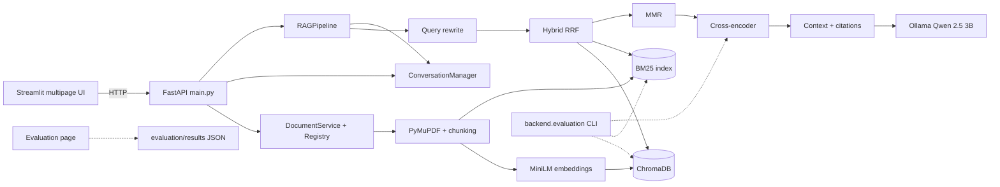

# RAG PDF Intelligence

Local, **CPU-only** conversational question answering over your own PDFs.

FastAPI backend · Streamlit multipage UI · ChromaDB dense retrieval · BM25 · Reciprocal Rank Fusion · MMR · cross-encoder reranking · Ollama (Qwen 2.5 3B) · SQLite document registry and chat history · offline evaluation harness.

> **Status:** Capstone Phases 2–6 are complete (reliability, multi-document chat, UI, evaluation, QA). This is a portfolio / demo system, **not** a hosted production product. Authentication and multi-user isolation are not implemented.


---

## Problem statement

Teams often need answers grounded in internal PDFs without sending documents to a cloud LLM. Generic chat UIs also struggle with multi-document scope, citations, and proving whether retrieval quality improved after pipeline changes.

This project addresses that with:

1. A local RAG stack that keeps PDFs, vectors and conversation history on disk.
2. Explicit multi-document selection enforced through every retrieval stage.
3. An offline evaluation framework that compares retrieval modes on manually labelled questions.

---

## Key features

- PDF upload, duplicate detection (SHA-256), replace, delete and startup reconciliation
- Hybrid retrieval: dense (Chroma) + BM25 fused with Reciprocal Rank Fusion
- MMR diversification and MiniLM cross-encoder reranking
- Conversational follow-ups via query rewriting and SQLite history
- Multi-document chat by registry `document_ids` (or all indexed docs)
- Citations with original filename, page, chunk id and text snippet
- Streamlit multipage UI: Dashboard, AI Chat, Document Library, Chat History, RAG Evaluation
- Offline evaluation: Precision@K, Recall@K, MRR, latency across four retrieval modes
- Hermetic pytest suite (temporary dirs; does not mutate real `data/` / `vector_db/`)

---

## Technology stack

| Layer | Choice |
|---|---|
| Language | Python 3.10 |
| API | FastAPI, Uvicorn |
| UI | Streamlit |
| PDF text | PyMuPDF |
| Chunking | LangChain recursive character splitter |
| Embeddings | `sentence-transformers/all-MiniLM-L6-v2` (CPU) |
| Vector DB | ChromaDB |
| Sparse retrieval | rank-bm25 |
| Reranker | `cross-encoder/ms-marco-MiniLM-L-6-v2` (CPU) |
| LLM | Ollama `qwen2.5:3b` |
| Persistence | SQLite (`documents.db`, `conversations.db`) |

---

## Screenshots

Add captures under [`docs/screenshots/`](docs/screenshots/README.md). Placeholders:

| Page | File |
|---|---|
| Dashboard | `docs/screenshots/01-dashboard.png` |
| AI Chat | `docs/screenshots/02-chat.png` |
| Document Library | `docs/screenshots/03-library.png` |
| Chat History | `docs/screenshots/04-history.png` |
| RAG Evaluation | `docs/screenshots/05-evaluation.png` |

After you save the PNG files above, uncomment or add the image embeds in a follow-up commit. Until then this section stays as placeholders so the README does not show broken images on GitHub.

---

## System architecture

See also [`docs/ARCHITECTURE.md`](docs/ARCHITECTURE.md).



---

## Document ingestion pipeline

```
Upload PDF
  → validate type/size (%PDF- header)
  → SHA-256 duplicate check (SQLite unique file_hash)
  → store under data/uploads/<uuid>_<name>.pdf
  → registry status = processing
  → PyMuPDF page text (empty pages skipped)
  → recursive chunks (default size 1000, overlap 200)
  → Chroma vectors + BM25 rebuild
  → registry status = indexed
```

Replace is journalled (`operations` table): old version stays searchable until the registry switches, then old vectors/files are cleaned up. Interrupted delete/replace/upload states are finished or rolled back by `DocumentService.reconcile()` at API startup.

---

## Retrieval and generation pipeline

```
Question + session_id (+ optional document_ids)
  → resolve_search: indexed docs only; build Chroma/BM25 filters + citation labels
  → load chat history
  → rewrite follow-up into a standalone query (Ollama)
  → hybrid search (dense + BM25 + RRF)
  → MMR
  → cross-encoder rerank (top_n final context chunks)
  → build_context + citations (snippet ≤ 400 chars)
  → grounded Qwen answer (or fixed no-answer sentence)
  → persist user/assistant messages in SQLite
```

A no-answer response returns `citations: []` in both the HTTP body and stored metadata.

---

## Dense, BM25, RRF, MMR and reranking

| Stage | Role in this repo |
|---|---|
| **Dense** | Chroma cosine similarity over MiniLM embeddings (`vector_store.search_documents`) |
| **BM25** | Keyword ranking over the same chunk corpus (`bm25_retriever.search`) |
| **RRF** | Reciprocal Rank Fusion in `hybrid_retriever.py` (`score += 1/(k+rank)`, default `k=60`) |
| **MMR** | Diversifies hybrid hits before reranking (`mmr.py`) |
| **Rerank** | Cross-encoder scores query–chunk pairs and keeps the top `final_k` (`reranker.py`) |

Offline evaluation compares dense, BM25, hybrid (RRF) and hybrid+rerank **without** conversation rewrite or MMR, so modes stay comparable.

---

## Multi-document chat

- UI sends `document_ids` for an explicit selection.
- Omitting `document_ids` searches every **indexed** document.
- `document_ids: []` is rejected (`422`).
- Legacy `source` (stored filename) still works; conflicting `source` + `document_ids` → `422`.
- Filters apply to dense and BM25; chunks outside the selection are dropped before context/citations.

---

## Evaluation methodology

Documented in [`evaluation/README.md`](evaluation/README.md).

- Manually labelled dataset: `evaluation/datasets/capstone_v1.json` (35 verified questions).
- Labels use `doc_key` + page (optional `chunk_ids`); registry IDs are resolved at runtime.
- Modes: dense, BM25, hybrid, hybrid_rerank on the **same** questions and top-K.
- Metrics: Precision@K, Recall@K (distinct labelled units), MRR, latency.
- Citation page match is a **proxy** only; faithfulness / answer relevance are manual.
- Full per-question JSON under `evaluation/results/` is gitignored (contains chunk text). Public aggregate summary: [`docs/evaluation_results.md`](docs/evaluation_results.md).

---

## Actual evaluation results

Latest verified retrieval run: **`20261114T121437Z_e1eca06c`**, top_k=5, 35 questions, CPU.

| Mode | P@5 | R@5 | MRR | Mean latency |
|---|---|---|---|---|
| dense | 0.2514 | 0.9429 | 0.7295 | 0.0183 s |
| bm25 | 0.2457 | 0.9429 | 0.8381 | 0.0004 s |
| hybrid | 0.2743 | 1.0000 | 0.8857 | 0.0194 s |
| hybrid + rerank | 0.2743 | 1.0000 | 0.9095 | 0.6048 s |

These are experimental measurements on the labelled notes corpus, not production SLOs.

---

## Installation (CPU)

```bash
# From the project root (the folder that contains backend/ and frontend/)
conda create -n rag-pdf python=3.10 -y
conda activate rag-pdf

# CPU PyTorch first — do not install CUDA wheels for this project
pip install torch --index-url https://download.pytorch.org/whl/cpu
pip install -r requirements-dev.txt

cp .env.example .env   # optional on Linux; defaults work
```

On Windows: `copy .env.example .env`. Cross-platform behaviour is intended, but this packaging pass was validated on Linux.

---

## Ollama / Qwen setup

1. Install [Ollama](https://ollama.com).
2. Pull the model used by `backend/llm.py`:

```bash
ollama pull qwen2.5:3b
```

3. Keep Ollama running (default `http://127.0.0.1:11434`).
4. `/health` reports `llm_available` separately. A model outage marks the API **degraded**, not unavailable.

---

## Run backend and frontend

```bash
# terminal 1 — models load at startup (slow on CPU the first time)
uvicorn backend.main:app --host 127.0.0.1 --port 8000

# terminal 2 — from the same project root
streamlit run frontend/app.py
```

- API docs: <http://127.0.0.1:8000/docs>
- UI: URL printed by Streamlit (usually <http://127.0.0.1:8501>)

---

## Evaluation commands

```bash
python -m backend.evaluation dataset-info --dataset evaluation/datasets/capstone_v1.json

# Small CPU smoke run
python -m backend.evaluation retrieve \
  --dataset evaluation/datasets/capstone_v1.json --top-k 5 --limit 5

# Full verified retrieval comparison
python -m backend.evaluation retrieve \
  --dataset evaluation/datasets/capstone_v1.json --top-k 5

python -m backend.evaluation list-runs
```

Optional answer generation (needs Ollama; slower):

```bash
python -m backend.evaluation answers \
  --dataset evaluation/datasets/capstone_v1.json --limit 3
```

---

## API endpoints

| Method | Path | Purpose |
|---|---|---|
| `GET` | `/health` | Backend / Chroma / Ollama flags + counts |
| `POST` | `/upload` | Index a PDF (`201` / `409` duplicate) |
| `GET` | `/documents` | List registry records |
| `GET` | `/documents/{id}` | One record |
| `PUT` | `/documents/{id}` | Replace PDF |
| `DELETE` | `/documents/{id}` | Delete file, vectors, BM25, registry row |
| `POST` | `/chat` | Ask; optional `document_ids` or legacy `source` |
| `POST/GET/PATCH/DELETE` | `/sessions[/{id}]` | Conversation CRUD |
| `DELETE` | `/sessions/{id}/messages` | Clear messages; keep session + title |

---

## Tests

```bash
pytest
```

Hermetic suites only (`pytest.ini`): document lifecycle, API, reliability, evaluation metrics, system QA workflows, frontend AppTest, CPU config, conversation persistence.

Phase 6 result: **104 passed**, 0 failed, 0 skipped.

Older `tests/test_*.py` scripts that load real models into the live `vector_db/` are **excluded** on purpose.

---

## Project layout

```
backend/           FastAPI app, RAG modules, evaluation package
frontend/          Streamlit multipage UI
evaluation/        Datasets, README, local results (gitignored JSON)
docs/              Architecture, published eval summary, LinkedIn drafts, screenshots guide
tests/             Hermetic pytest suites
data/              Local runtime DBs + uploads (gitignored)
vector_db/         Chroma persistence (gitignored)
```

---

## Limitations

- No authentication or multi-tenant isolation
- Synchronous indexing inside upload/replace requests
- `page_count` counts pages with extractable text, not scanned blank pages
- Page-level evaluation labels inflate Precision when many chunks share a page
- Faithfulness / answer relevance are manual; not auto-scored
- Opening Chroma can rewrite `vector_db/chroma.sqlite3` internals even for reads
- First model load on CPU is slow; needs disk space for Hugging Face caches
- Linux-verified packaging; Windows not re-tested in Phase 7

---

## Future improvements

- OCR for scanned PDFs and better table extraction
- Background indexing jobs
- Auth and per-user document scopes
- Token-aware chunking
- Docker Compose + CI
- Larger labelled evaluation set with chunk-id labels
- Optional streaming answers once stable with Ollama

---

## Configuration

| Variable | Default | Meaning |
|---|---|---|
| `DATA_DIR` | `data` | Uploads + SQLite DBs |
| `VECTOR_DB_DIR` | `vector_db` | Chroma directory |
| `MAX_UPLOAD_MB` | `20` | Upload size limit |
| `CHUNK_SIZE` / `CHUNK_OVERLAP` | `1000` / `200` | Chunking |
| `PRUNE_ORPHAN_VECTORS` | `false` | Optional orphan vector deletion at reconcile |
| `RAG_API_URL` | `http://127.0.0.1:8000` | Streamlit → API |
| `OLLAMA_BASE_URL` | `http://127.0.0.1:11434` | Health probe target |
| `OLLAMA_HEALTH_TIMEOUT` | `1` | Seconds |

Copy `.env.example` to `.env` for local overrides. Never commit `.env`.

---

## License / privacy

Do not commit personal PDFs, API keys, or full evaluation JSON dumps that embed document text. Use `.gitignore` defaults and the published aggregate summary in `docs/evaluation_results.md`.
