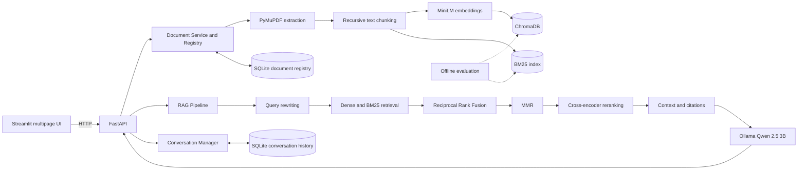

# Hybrid RAG PDF Intelligence

A local, CPU-friendly Retrieval-Augmented Generation (RAG) application
for asking grounded questions across PDF documents.

The project combines a **FastAPI backend**, **Streamlit multipage
interface**, **dense and sparse retrieval**, **Reciprocal Rank Fusion
(RRF)**, **MMR**, **cross-encoder reranking**, and a locally hosted
**Qwen 2.5 3B** model through Ollama.

> **Status:** Portfolio/demo project, not a hosted production service.
> Authentication and multi-user isolation are not implemented.

## Overview

Teams often need answers grounded in internal PDFs while keeping
document content under local control. A basic chat interface does not
necessarily provide reliable document scoping, traceable citations,
conversational follow-ups, or a way to measure retrieval quality.

This project provides: 1. A local document-question-answering workflow.
2. Explicit multi-document selection applied throughout retrieval. 3.
Source citations containing document and page information. 4. Hybrid
dense and keyword retrieval followed by reranking. 5. An offline
evaluation harness for comparing retrieval strategies.

## Key features

-   PDF upload, SHA-256 duplicate detection, replace, delete, and
    startup reconciliation.
-   Hybrid retrieval: ChromaDB dense retrieval combined with BM25 and
    RRF.
-   MMR diversification and MiniLM cross-encoder reranking.
-   Conversational follow-ups using query rewriting and SQLite-backed
    chat history.
-   Multi-document chat using `document_ids`, or search across all
    indexed documents.
-   Citations with original filename, page, chunk ID, and text snippet.
-   Streamlit pages: Dashboard, AI Chat, Document Library, Chat History,
    and RAG Evaluation.
-   Offline evaluation using Precision@K, Recall@K, MRR, and latency.
-   Hermetic pytest suites designed not to modify live upload/vector
    database directories.

## Technology stack

  Layer              Technology
  ------------------ ------------------------------------------
  Language           Python 3.10
  API                FastAPI, Uvicorn
  Frontend           Streamlit
  PDF extraction     PyMuPDF
  Text splitting     LangChain RecursiveCharacterTextSplitter
  Embeddings         `sentence-transformers/all-MiniLM-L6-v2`
  Vector database    ChromaDB
  Sparse retrieval   BM25 (`rank-bm25`)
  Fusion             Reciprocal Rank Fusion
  Diversification    Maximal Marginal Relevance
  Reranker           `cross-encoder/ms-marco-MiniLM-L-6-v2`
  Local LLM          Ollama `qwen2.5:3b`
  Persistence        SQLite

## Architecture

See [`docs/ARCHITECTURE.md`](docs/ARCHITECTURE.md).



## Document ingestion

``` text
PDF upload
  -> validate file type, size, and PDF header
  -> calculate SHA-256 and check for duplicates
  -> save uploaded file
  -> create/update document registry state
  -> extract page text with PyMuPDF
  -> split text into chunks
  -> create embeddings and index chunks in ChromaDB
  -> build/update BM25 index
  -> mark document as indexed
```

Default chunk configuration: **1,000 characters** with **200 characters
overlap**.

Document replacement uses a journalled operation recorded in the
`operations` table. Startup reconciliation handles interrupted upload,
replace, and delete operations.

## Retrieval and answer generation

``` text
Question + session ID + optional document IDs
  -> resolve indexed document scope
  -> load conversation history
  -> rewrite follow-up as a standalone query when needed
  -> dense retrieval and BM25 retrieval
  -> Reciprocal Rank Fusion
  -> MMR diversification
  -> cross-encoder reranking
  -> build context and source citations
  -> generate grounded answer with local Qwen model
  -> persist conversation messages in SQLite
```

If retrieved context does not contain enough information, the
application can return its configured no-answer response rather than
inventing an answer. No-answer responses should not expose supporting
citations.

## Retrieval components

  -----------------------------------------------------------------------
  Component                           Purpose
  ----------------------------------- -----------------------------------
  Dense retrieval                     Finds semantically similar chunks
                                      using MiniLM embeddings stored in
                                      ChromaDB.

  BM25                                Retrieves chunks using lexical
                                      keyword matching.

  RRF                                 Combines ranked dense and BM25
                                      results.

  MMR                                 Reduces redundancy and diversifies
                                      selected results.

  Cross-encoder                       Scores query/chunk pairs and
                                      reranks candidates before context
                                      construction.
  -----------------------------------------------------------------------

The offline comparison evaluates dense, BM25, hybrid RRF, and
hybrid-plus-reranking modes on the same labelled questions and top-K
setting. Conversation rewriting and MMR are not included in that
comparison, keeping evaluated retrieval modes comparable.

## Multi-document behaviour

-   The UI can send `document_ids` to scope a question to selected
    documents.
-   If `document_ids` is omitted, retrieval can search all indexed
    documents.
-   An empty `document_ids` list is rejected with HTTP `422`.
-   The legacy `source` filename parameter is supported.
-   Conflicting `source` and `document_ids` values are rejected.
-   Document filters are applied to dense and sparse retrieval so
    out-of-scope chunks do not enter the final context.

## Evaluation

See [`evaluation/README.md`](evaluation/README.md) for the methodology.

-   Dataset: `evaluation/datasets/capstone_v1.json`
-   Labelled questions: 35
-   Labels: document key and page, with optional chunk IDs
-   Modes: dense, BM25, hybrid RRF, and hybrid reranking
-   Metrics: Precision@K, Recall@K, MRR, and mean latency
-   Citation page matching is a proxy; faithfulness and answer relevance
    require manual review.

Full per-question results are kept locally and ignored by Git because
they can contain document text. The aggregate summary is in
[`docs/evaluation_results.md`](docs/evaluation_results.md).

### Recorded retrieval results

Documented CPU run: `20261114T121437Z_e1eca06c`, top-K = 5, 35 labelled
questions.

  Retrieval mode         Precision@5   Recall@5      MRR   Mean latency
  -------------------- ------------- ---------- -------- --------------
  Dense                       0.2514     0.9429   0.7295       0.0183 s
  BM25                        0.2457     0.9429   0.8381       0.0004 s
  Hybrid (RRF)                0.2743     1.0000   0.8857       0.0194 s
  Hybrid + reranking          0.2743     1.0000   0.9095       0.6048 s

These are experimental measurements on the labelled evaluation corpus,
not production service-level objectives. Reranking increases retrieval
latency in this run.

## Screenshots

Add captures under [`docs/screenshots/`](docs/screenshots/README.md).

  Application page   Suggested filename
  ------------------ --------------------------------------
  Dashboard          `docs/screenshots/01-dashboard.png`
  AI Chat            `docs/screenshots/02-chat.png`
  Document Library   `docs/screenshots/03-library.png`
  Chat History       `docs/screenshots/04-history.png`
  RAG Evaluation     `docs/screenshots/05-evaluation.png`

Add image embeds after the screenshots have been captured so the README
does not show broken image links.

## Installation

### 1. Create a Python environment

``` bash
conda create -n rag-pdf python=3.10 -y
conda activate rag-pdf
```

### 2. Install CPU PyTorch

``` bash
pip install torch --index-url https://download.pytorch.org/whl/cpu
```

### 3. Install project dependencies

``` bash
pip install -r requirements.txt
```

### 4. Configure environment variables

Linux/macOS:

``` bash
cp .env.example .env
```

Windows PowerShell:

``` powershell
Copy-Item .env.example .env
```

The application defaults can be used for a local run. Edit `.env` only
when local overrides are needed.

## Ollama setup

1.  Install [Ollama](https://ollama.com).
2.  Download the model:

``` bash
ollama pull qwen2.5:3b
```

3.  Ensure Ollama is running at `http://127.0.0.1:11434`.

The API health endpoint reports LLM availability separately. A model
outage can leave the API running in a degraded state.

## Run the application

Start the backend from the project root:

``` bash
uvicorn backend.main:app --host 127.0.0.1 --port 8000
```

In a second terminal, from the same project root:

``` bash
streamlit run frontend/app.py
```

-   API documentation: `http://127.0.0.1:8000/docs`
-   Streamlit UI: usually `http://127.0.0.1:8501`

The first startup can take longer because embedding and reranking models
may need to be loaded or downloaded.

## Evaluation commands

Inspect the dataset:

``` bash
python -m backend.evaluation dataset-info --dataset evaluation/datasets/capstone_v1.json
```

Run a small retrieval smoke test:

``` bash
python -m backend.evaluation retrieve \
  --dataset evaluation/datasets/capstone_v1.json \
  --top-k 5 \
  --limit 5
```

Run the full retrieval comparison:

``` bash
python -m backend.evaluation retrieve \
  --dataset evaluation/datasets/capstone_v1.json \
  --top-k 5
```

List recorded runs:

``` bash
python -m backend.evaluation list-runs
```

Optional answer-generation evaluation requires Ollama:

``` bash
python -m backend.evaluation answers \
  --dataset evaluation/datasets/capstone_v1.json \
  --limit 3
```

## API overview

  ---------------------------------------------------------------------------
  Method                  Endpoint                    Purpose
  ----------------------- --------------------------- -----------------------
  `GET`                   `/health`                   Backend, ChromaDB, and
                                                      Ollama health
                                                      information

  `POST`                  `/upload`                   Upload and index a PDF

  `GET`                   `/documents`                List document registry
                                                      records

  `GET`                   `/documents/{id}`           Retrieve one document
                                                      record

  `PUT`                   `/documents/{id}`           Replace a document

  `DELETE`                `/documents/{id}`           Delete a document and
                                                      indexed data

  `POST`                  `/chat`                     Ask a question,
                                                      optionally scoped by
                                                      `document_ids`

  `POST`, `GET`, `PATCH`, `/sessions`                 Conversation session
  `DELETE`                                            operations

  `DELETE`                `/sessions/{id}/messages`   Clear messages while
                                                      retaining the session
  ---------------------------------------------------------------------------

See the FastAPI interactive documentation at `/docs` for request and
response schemas.

## Tests

Run the configured test suite:

``` bash
python -m pytest
```

The hermetic suites cover document lifecycle, API behaviour,
reliability, evaluation metrics, system QA workflows, frontend AppTest,
CPU configuration, and conversation persistence. Older manual test
scripts that load real models and interact with the live vector database
are excluded by `pytest.ini`.

-   Previously recorded Linux run: **104 passed**.
-   Latest Windows run during portfolio preparation: **99 passed, 3
    failed, and 4 errors**.

The Windows run was not fully green; do not describe the test suite as
passing on Windows until those failures and errors are resolved.

## Project structure

``` text
rag-pdf-chatbot/
├── backend/          # FastAPI application and RAG pipeline
├── frontend/         # Streamlit multipage application
├── evaluation/       # Evaluation dataset and documentation
├── docs/             # Architecture and evaluation documentation
├── tests/            # Automated test suites
├── data/             # Local uploads and SQLite databases (gitignored)
├── vector_db/        # ChromaDB persistence (gitignored)
├── requirements.txt  # Runtime and testing dependencies
├── pytest.ini
└── README.md
```

## Limitations

-   Authentication and multi-user isolation are not implemented.
-   Document indexing runs synchronously during upload and replacement.
-   `page_count` represents pages with extractable text; scanned-page
    OCR is not included.
-   Page-level evaluation labels can affect Precision when multiple
    chunks belong to the same page.
-   Faithfulness and answer relevance are not automatically scored.
-   The first model load can be slow on CPU and requires disk space for
    model caches.
-   The latest Windows test run was not fully green.

## Potential next improvements

-   OCR support for scanned PDFs and improved table extraction.
-   Background document indexing jobs.
-   Authentication and per-user document access controls.
-   Token-aware chunking.
-   Docker Compose and continuous integration.
-   A larger evaluation set with chunk-level labels.
-   Streaming responses after stability testing with Ollama.

## Configuration

  ----------------------------------------------------------------------------
  Variable                  Default                    Purpose
  ------------------------- -------------------------- -----------------------
  `DATA_DIR`                `data`                     Uploads and SQLite
                                                       databases

  `VECTOR_DB_DIR`           `vector_db`                ChromaDB persistence
                                                       directory

  `MAX_UPLOAD_MB`           `20`                       Maximum upload size

  `CHUNK_SIZE`              `1000`                     Text chunk size

  `CHUNK_OVERLAP`           `200`                      Chunk overlap

  `PRUNE_ORPHAN_VECTORS`    `false`                    Optional orphan-vector
                                                       cleanup during
                                                       reconciliation

  `RAG_API_URL`             `http://127.0.0.1:8000`    Streamlit-to-API URL

  `OLLAMA_BASE_URL`         `http://127.0.0.1:11434`   Ollama health-check
                                                       target

  `OLLAMA_HEALTH_TIMEOUT`   `1`                        Health-check timeout in
                                                       seconds
  ----------------------------------------------------------------------------

Never commit `.env`, private PDFs, API keys, or evaluation result dumps
containing source-document text.

## License and privacy

Keep personal documents, secrets, and full evaluation JSON files
containing document text out of the repository. Use the provided
`.gitignore`.

No license has been specified in this repository yet. Add a license file
if you intend to grant others explicit permission to use, modify, and
distribute the project.
