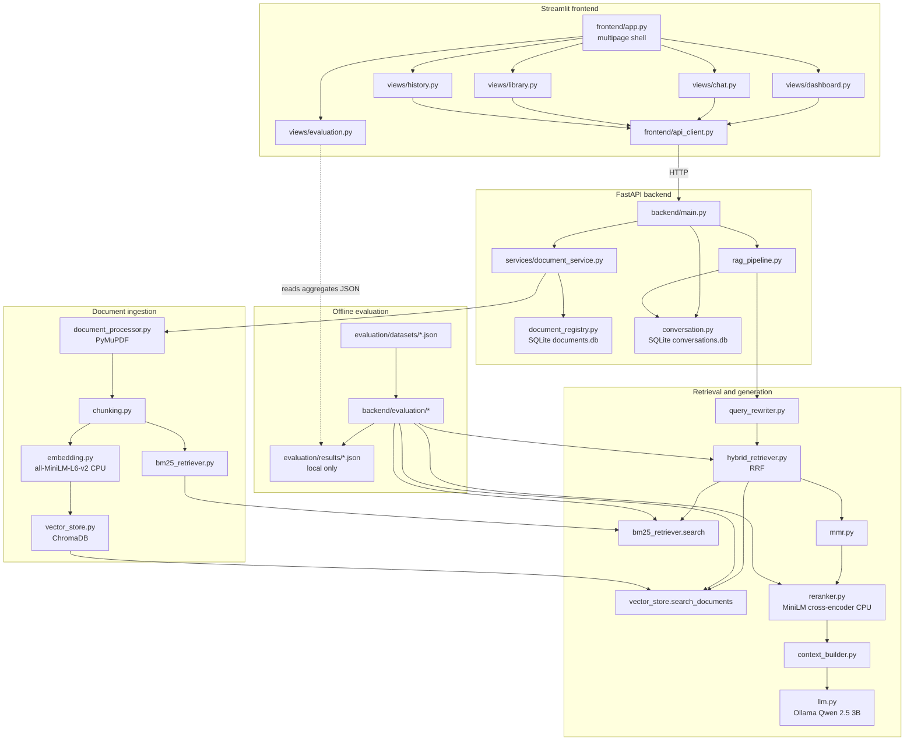

# System architecture

Module names and data flow match the current codebase under `backend/` and `frontend/`.

## Request paths

| User action | Primary modules |
|---|---|
| Upload / replace / delete PDF | `main.py` → `DocumentService` → registry + files + Chroma + BM25 rebuild |
| Ask a question | `main.py` → `resolve_search` → `RAGPipeline.ask` |
| Manage chats | `main.py` → `ConversationManager` |
| Run evaluation | `python -m backend.evaluation` (does not call `/chat`) |
